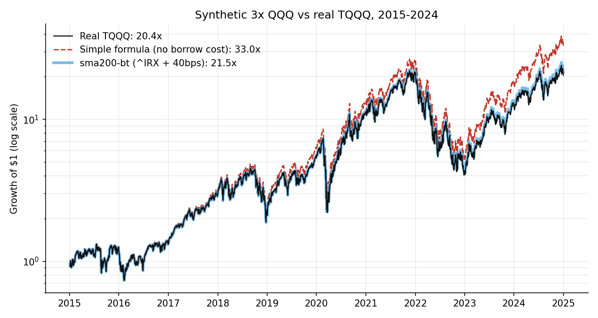

# sma200-bt

[](https://pypi.org/project/sma200-bt/)
[](https://github.com/prismlfx/sma200-bt/blob/master/LICENSE)

**Testfolio-compatible synthetic leveraged-ETF return series for Python, with proper borrow-cost modeling.** Calibrated against real TQQQ to within 5% over the 2015-2024 window.

Most synthetic LETF backtests floating around Reddit, Bogleheads, and finance blogs use the simplified formula `L * daily_return - ER / 252`, which omits the daily borrow cost real leveraged ETFs pay on their swap-financed exposure. That simplified formula **overstates real TQQQ by 62%** over 2015-2024.

This package implements the full formula:

```
daily_return = L * underlying_return
             - ER / 252
             - (L - 1) * (borrow_rate + spread) / 252
```

The third term models the swap-financing cost that ProShares (and every other swap-based LETF issuer) pays on the leveraged portion every day. It matches what [Testfolio](https://testfol.io) does internally and what actual fund NAVs reflect.

## Calibration vs real TQQQ (2015-2024)

| Method | Final wealth multiple ($1 →) | Drift vs real TQQQ |
|---|---:|---:|
| **Real TQQQ** (ProShares fund) | 20.41× | baseline |
| Simple formula (no borrow cost) | 33.00× | **+62%** |
| **sma200-bt** (^IRX + 40bps spread) | 21.46× | **+5%** |

The +5% residual is plausibly tracking error plus the 40bps spread being a midpoint estimate of ProShares' actual swap pricing. Well within the noise band for research purposes.



Reproduce the table and chart from live Yahoo Finance data:

```bash
pip install sma200-bt matplotlib
python examples/calibrate_tqqq.py --plot
```

## Install

```bash
pip install sma200-bt
```


## Usage

```python
import yfinance as yf
from sma200_bt import synthetic_letf_returns, fetch_tbill_rate, compound

# Pull underlying daily returns
qqq = yf.download("QQQ", start="1999-03-10", auto_adjust=False, progress=False)["Adj Close"]
qqq_ret = qqq.pct_change().dropna()

# Pull the borrow rate series (13-week T-bill via ^IRX)
tbill = fetch_tbill_rate(qqq_ret.index[0], qqq_ret.index[-1])

# Build synthetic TQQQ with proper borrow cost
tqqq_syn = synthetic_letf_returns(
    qqq_ret,
    leverage=3.0,
    expense_ratio=0.0086,     # TQQQ ER
    borrow_rate=tbill,
    borrow_spread=0.0040,     # 40bps over T-bill, ProShares swap-typical
)

# Compound into an equity curve
equity = compound(tqqq_syn, initial=10000.0)
print(f"Final value: ${equity.iloc[-1]:,.0f}")
```

## Why borrow cost matters

When short rates are near zero (most of 2009-2021), the borrow term is tiny and the simple formula gives nearly identical results. But during high-rate regimes:

- **1970s stagflation:** ~8% T-bill rate → 3x funds paid ~16% annualized in financing drag
- **Early 2000s:** ~3-5% T-bill rate → ~6-10% annual drag
- **2022 onward:** Fed Funds hiked from 0.25% to 5.5% → meaningful drag returned

Synthetic backtests that ignore borrow cost produce fantasy numbers for these periods. A synthetic 3x S&P "earning billions since 1940" is a methodology artifact, not a real result.

## Compatibility with Testfolio

`sma200-bt` uses the same daily formula as Testfolio's leveraged-fund synthesis. Results will not be bit-for-bit identical (Testfolio uses Fed Funds Effective Rate where this library uses ^IRX as the default, and the spread assumption may differ), but they will match to within a few basis points of CAGR over multi-decade windows.

## What this library is NOT

- **Not a portfolio backtest engine.** Use [bt](https://github.com/pmorissette/bt), [vectorbt](https://github.com/polakowo/vectorbt), or [zipline](https://github.com/quantopian/zipline) for that. This library produces a return *series*; what you do with it is up to you.
- **Not investment advice.** This is a research tool. Don't size positions based on backtest output. See the LICENSE for the full disclaimer.
- **Not a rigorous model of inverse leverage.** The formula approximates inverse funds (e.g. SH, PSQ) but real inverse-fund mechanics differ. Use Testfolio for production-grade inverse backtests.

## API reference

### `synthetic_letf_returns(underlying_returns, leverage, expense_ratio, borrow_rate=None, borrow_spread=0.0040)`

Build a synthetic leveraged-ETF daily return series.

- `underlying_returns`: `pd.Series` of daily returns, DatetimeIndex
- `leverage`: float (`2.0` for 2x, `3.0` for 3x, `-1.0` for -1x inverse)
- `expense_ratio`: annual ER as decimal (`0.0086` for 0.86%)
- `borrow_rate`: `None`, `float`, or `pd.Series` of daily rates as decimal. Use `fetch_tbill_rate()` for ^IRX. `None` falls back to simple-mode (logs a warning).
- `borrow_spread`: float, additional bps above base rate. Default `0.0040` (40bps).

Returns: `pd.Series` of daily LETF returns aligned to `underlying_returns.index`.

### `fetch_tbill_rate(start, end, fallback_rate=0.04)`

Pull the 13-week T-bill rate (`^IRX` via yfinance) as a daily decimal series.

### `compound(returns, initial=1.0)`

Compound a daily return series into an equity curve.

## Background

This library was extracted from internal research at [sma200.trade](https://sma200.trade) after discovering that synthetic LETF numbers we'd published on Reddit had been computed with the simplified formula. Full writeup of the bug, the fix, and what the corrected numbers actually show about the SMA200 trend filter: **[The Hidden Cost Every Leveraged-ETF Backtest Ignores](https://sma200.trade/articles/leveraged-etf-borrow-cost)**.

## Research built on it

Studies at sma200.trade that use these series:

- [Borrow-cost correction for synthetic leveraged ETFs](https://sma200.trade/research/borrow-cost-correction-synthetic-letf): the bug, the fix, and revised synthetic TQQQ numbers back to 1999
- [Full leverage spectrum](https://sma200.trade/research/full-leverage-spectrum): 1x, 2x and 3x, buy-and-hold vs a 200-day SMA filter, across SPY, QQQ, ^SOX, gold and silver
- [Leverage vs volatility per underlying](https://sma200.trade/research/leverage-vs-volatility-per-underlying): how volatility decay interacts with leverage and the SMA filter on SPY, QQQ and ^SOX

## Run the tests

```bash
git clone https://github.com/prismlfx/sma200-bt.git
cd sma200-bt
pip install -e ".[dev]"
pytest
```

Six test cases pin the formula behavior across: simple-mode parity, high-rate borrow drag, zero-rate parity, inverse leverage edge case, Series-based rate alignment, and compound-helper correctness.

## License

MIT. See `LICENSE`. For informational and educational use only; not investment advice.

## Issues, PRs, discussion

Open an issue at https://github.com/prismlfx/sma200-bt/issues. PRs welcome for additional calibration data, real-fund cross-checks, or extending the inverse-leverage modeling.
